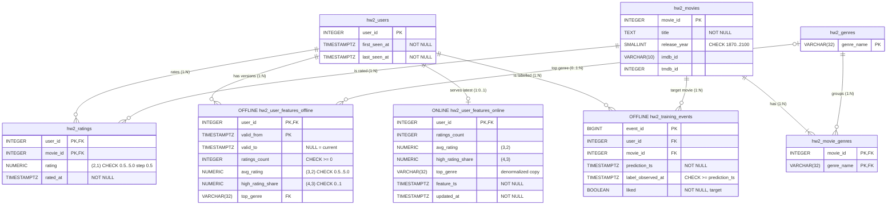

# goit-rdb-hw-02

Homework 1 (Topic 2): a data schema for movie recommendations on MovieLens Latest Small, with offline and online feature store layers and training data free of data leakage.

Everything is done in [hw02_movielens_feature_store.ipynb](hw02_movielens_feature_store.ipynb). PostgreSQL 16 starts through `pgserver`, the dataset is downloaded from GroupLens into `data/`, so the notebook passes Restart & Run All both in Colab and locally (`uv sync`).

## Files

- [hw02_movielens_feature_store.ipynb](hw02_movielens_feature_store.ipynb): DDL, loading, historical features, AS-OF queries, checks, normalization notes and reflection.
- [er_diagram.png](er_diagram.png): the ER diagram; it is also embedded in the notebook.
- [er_diagram.mmd](er_diagram.mmd): the same diagram as a text DSL (Mermaid); GitHub renders it below.

## What is inside

- **Entities:** `hw2_users`, `hw2_movies`, `hw2_genres`. Two N:M relationships through bridge tables: `users ↔ movies` through `hw2_ratings`, `movies ↔ genres` through `hw2_movie_genres`. The full dataset is loaded: 610 users, 9,742 movies, 100,836 ratings.
- **Offline:**
  - `hw2_user_features_offline`: 13 feature versions for users 106, 272 and 557 (five for 557) with `[valid_from, valid_to)`.
  - `hw2_training_events`: 13 events with `prediction_ts` and the `liked` label.
- **Online:** `hw2_user_features_online`, one denormalized row per user, refreshed from the current offline version through `ON CONFLICT DO UPDATE`.
- **Checks:**
  - feature values are recomputed from `hw2_ratings`, 0 differences;
  - 0 overlapping intervals and 0 gaps between versions;
  - the AS-OF join returns 13 rows, while a naive join on `user_id` returns 57, 35 of them with future features.

